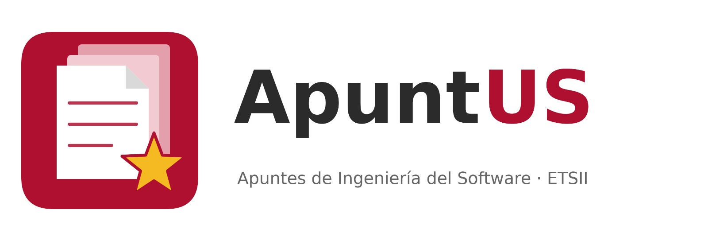
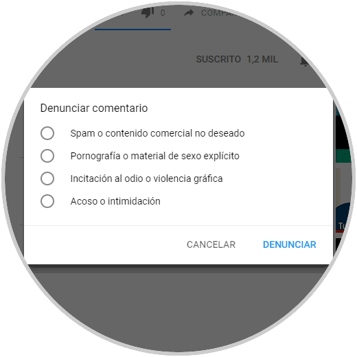
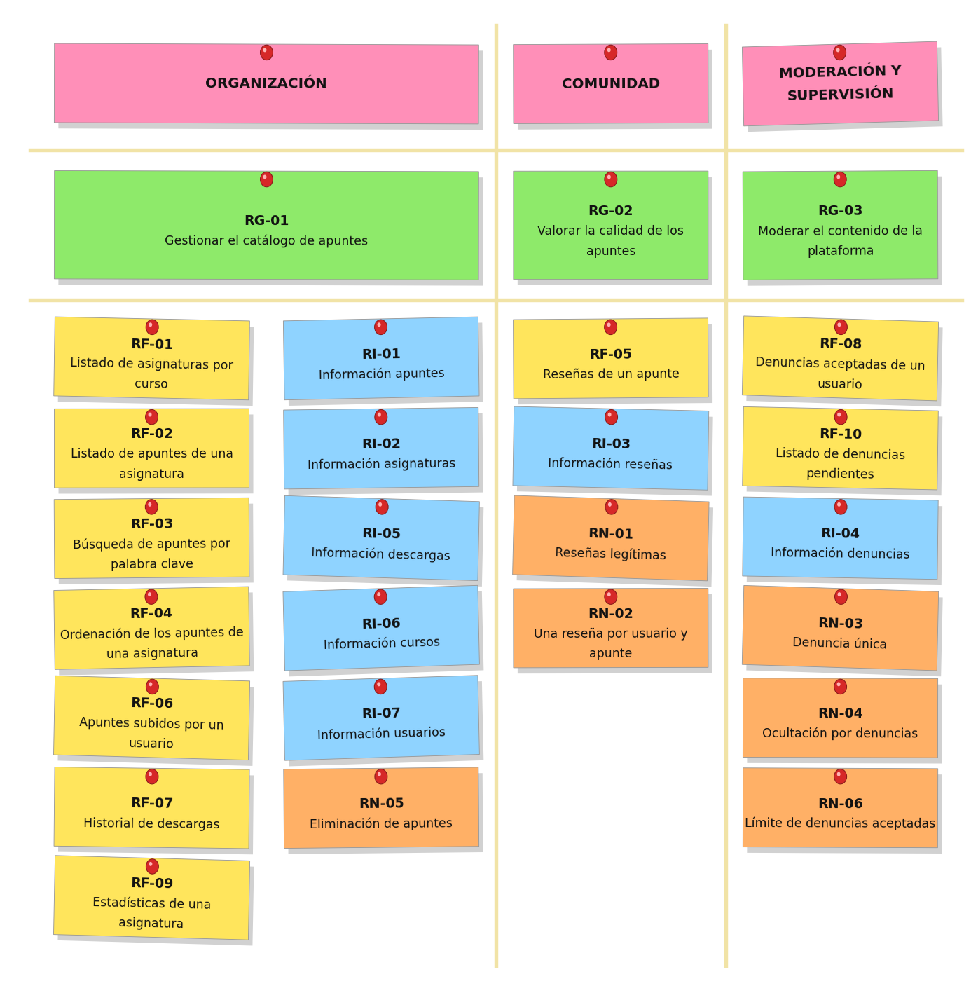
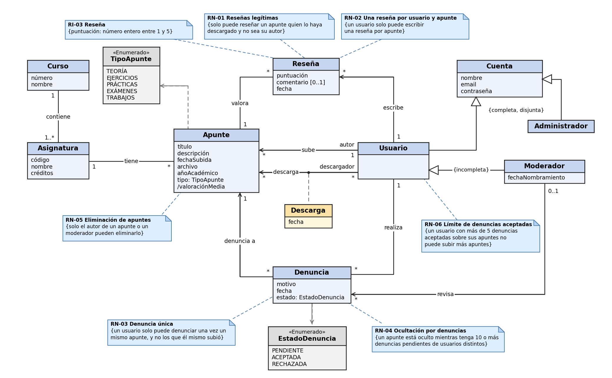
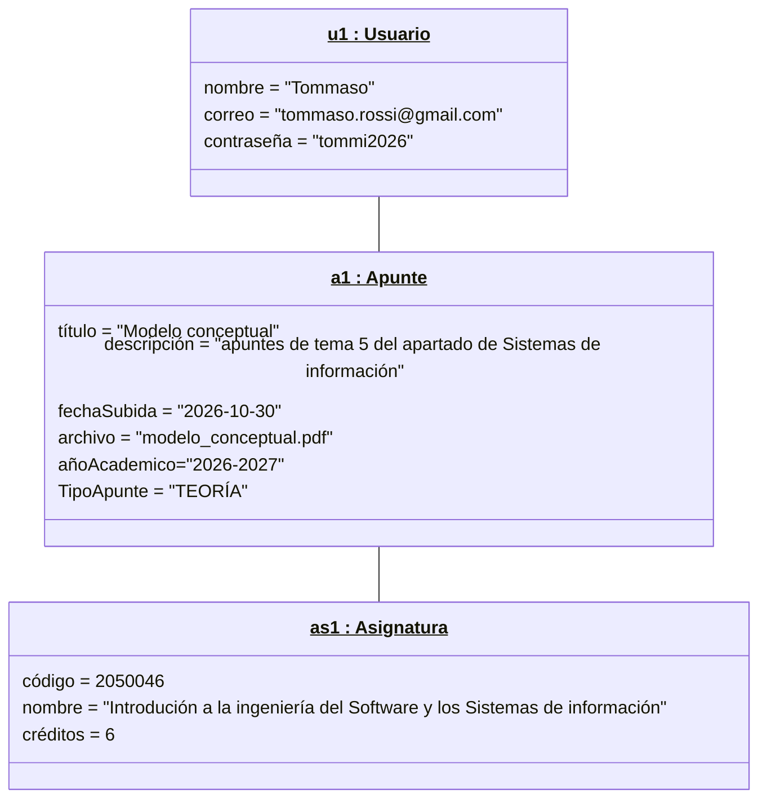

# ApuntUS

## Miembros del grupo L2-ABS-1

1. Baltasar Castro, Javier
1. Gómez Arias, Pablo
1. Steri, Giulia

## 1. Introducción al problema

### Contexto

El Grado en Ingeniería Informática – Ingeniería del Software de la Escuela Técnica Superior de Ingeniería Informática (ETSII) de la Universidad de Sevilla se organiza en cuatro cursos, cada uno con sus asignaturas. Los estudiantes están acostumbrados a utilizar ApuntUS, una web donde pueden subir y descargar apuntes de cada asignatura de la carrera.

### Clientes y Usuarios

El cliente es el alumnado de la titulación, que ha presentado una queja formal debido a la mala organización de la web. Los usuarios son los estudiantes del grado, que necesitan encontrar material fiable con el que apoyarse en sus estudios y compartir sus propios apuntes. Algunos de ellos actúan como moderadores, encargados de revisar el contenido, y además existe una administración responsable de gestionar la plataforma.

### Situación actual

El grado dispone de una web donde los estudiantes pueden subir apuntes, pero funciona sin ningún tipo de organización: todos los archivos se suben juntos, sin distinguir curso, asignatura ni tipo. Esto ha terminado ocasionando confusiones con los apuntes y un deterioro en el uso de la web. La web funciona sobre un servidor de base de datos MariaDB.

### Problemas detectados

- Dificultad para encontrar material: para localizar los apuntes de una asignatura hay que revisar un listado enorme.
- Material mezclado y desactualizado: los apuntes de teoría, ejercicios y exámenes están mezclados sin distinción, y no se sabe de qué año es cada uno.
- Ninguna garantía de calidad: no hay forma de saber qué apuntes son buenos antes de descargarlos. 
- Falta de control del contenido: no existe ningún método para retirar el material inadecuado.

### Expectativas

Por demanda estudiantil, se quiere realizar una renovación completa de la web, inspirada en otras como Wuolah, pero centrada en una única titulación (Ingeniería Informática – Ingeniería del Software). Este cambio debe permitir:

- Clasificar los apuntes por curso, asignatura y tipo, y buscarlos y ordenarlos por fecha, descargas o valoración.
- Que los estudiantes puedan valorar y comprobar la calidad de los apuntes con un sistema de reseñas de 1 a 5 estrellas.
- Denunciar apuntes inadecuados, para que un moderador los revise y se impida subir apuntes a los usuarios reincidentes.
- Que el administrador detecte las asignaturas con poco material para promover la subida de apuntes en aquellas que tengan mayor escasez.

Con ello se pretende que la web deje de estar completamente desorganizada y se convierta en una herramienta fiable y fácil de usar en la que se fomente la colaboración entre estudiantes, y que estos la utilicen para ahorrar tiempo y mejorar en los estudios.

## 2. Glosario de términos

|Término|Descripción|Imagen|
|-------|-----------|------|
|Año académico|Periodo lectivo en el que se elabora un apunte, expresado como dos años consecutivos (por ejemplo, 2026/27).||
|Apuntes|Documento de estudio que un usuario sube a la plataforma, asociado a una asignatura.||
|Denuncia|Aviso que un usuario presenta contra un apunte que considera inadecuado.||
|MariaDB|Sistema gestor de bases de datos sobre el que funciona la web.||
|Moderación|Conjunto de tareas para mantener el contenido de la plataforma en buen estado.||
|Ocultación|Situación en la que un apunte deja de aparecer en los listados y no puede descargarse.||
|Reseña|Valoración que un usuario escribe sobre un apunte que ha descargado.||
|Veto|Restricción que impide a un usuario subir nuevos apuntes.||
|Wuolah|Plataforma de intercambio de apuntes entre universitarios que sirve de referencia al proyecto.||

## 3. Visión general del sistema

### 3.1. Requisitos generales

#### RG-01 Gestionar el catálogo de apuntes

**Como** usuario,  
**quiero** encontrar, subir y descargar apuntes organizados por curso, asignatura y tipo, y que todas las asignaturas dispongan de material suficiente y variado,  
**para** compartir material de estudio y localizar rápidamente el que necesito. 

#### RG-02 Valorar la calidad de los apuntes

**Como** usuario,  
**quiero** valorar los apuntes que he descargado y consultar las valoraciones de los demás,  
**para** distinguir los apuntes de mayor calidad.  

#### RG-03 Moderar el contenido de la plataforma

**Como** moderador,  
**quiero** controlar los apuntes denunciados y a los usuarios que incumplen las normas,  
**para** mantener la calidad y la fiabilidad del contenido.  

### 3.2. Usuarios del sistema

#### Usuario

Es cualquier estudiante registrado en la plataforma. Puede consultar y buscar apuntes, ver las reseñas de estos, subir los suyos y eliminarlos, descargar los de otros compañeros, escribir reseñas y denunciar apuntes inadecuados. También puede consultar su historial de descargas y los apuntes subidos por otros autores.

#### Moderador

Es un usuario con permisos de moderación, por lo que puede hacer todo lo que hace un usuario. Además, revisa las denuncias y decide si se aceptan o se rechazan, consulta las denuncias aceptadas de cada usuario para detectar a los reincidentes, y puede eliminar apuntes de cualquier autor. Es el responsable de mantener el contenido de la plataforma en buen estado.

#### Administrador

Es el responsable de la gestión de la plataforma. No es un usuario que suba o descargue apuntes, sino que consulta información de gestión, como el número de apuntes de cada asignatura por tipo o la actividad de los moderadores. Además, gestiona las cuentas de la plataforma, entre ellas las de los moderadores.

## 4. Catálogo de requisitos

### 4.1. Requisitos funcionales

##### R.F.01. Listado de asignaturas por curso

**Como** usuario,  
**quiero** consultar las asignaturas de cada curso de la carrera,  
**para** encontrar rápidamente la asignatura que busco.  

##### R.F.02. Listado de apuntes de una asignatura

**Como** usuario,  
**quiero** consultar los apuntes de una asignatura filtrándolos por tipo (teoría, ejercicios, exámenes...),  
**para** acceder solo al material que necesito.  

##### R.F.03. Búsqueda de apuntes por palabra clave

**Como** usuario,  
**quiero** buscar apuntes por palabras del título, descripción o nombre del autor,  
**para** encontrar material sin tener que navegar por todas las asignaturas.  

##### R.F.04. Ordenación de los apuntes de una asignatura

**Como** usuario,  
**quiero** ordenar los apuntes de una asignatura según el criterio que elija (más recientes, más descargados o mejor valorados),  
**para** encontrar antes el material que más me conviene.  

##### R.F.05. Reseñas de un apunte

**Como** usuario,  
**quiero** consultar la valoración media y las reseñas de un apunte,  
**para** decidir si merece la pena descargarlo.  

##### R.F.06. Apuntes subidos por un usuario

**Como** usuario,  
**quiero** consultar los apuntes que ha subido un usuario,  
**para** encontrar más material de autores que me resultan fiables.  

##### R.F.07. Historial de descargas

**Como** usuario,  
**quiero** consultar el listado de apuntes que me he descargado,  
**para** volver a localizarlos fácilmente.  

##### R.F.08. Denuncias aceptadas de un usuario

**Como** moderador,  
**quiero** consultar el número total de denuncias aceptadas que tiene un usuario,  
**para** saber qué usuario está consistentemente rompiendo las normas.  

##### R.F.09. Listado de denuncias pendientes

**Como** moderador,  
**quiero** consultar las denuncias pendientes de revisar junto con el apunte denunciado,  
**para** moderar el contenido inadecuado.  

##### R.F.10. Estadísticas de una asignatura

**Como** administrador,  
**quiero** consultar cuántos apuntes tiene cada asignatura, desglosados por tipo,  
**para** detectar asignaturas con poco material.  

##### R.F.11. Listado de moderadores

**Como** administrador,  
**quiero** consultar el listado de moderadores junto con su fecha de nombramiento y el número de denuncias que ha revisado cada uno,  
**para** supervisar la actividad de moderación de la plataforma.  

#### 4.1.1. Requisitos de información

##### R.I.01. Información apuntes

**Como** usuario,  
**quiero** disponer de la siguiente información sobre los apuntes:  
- El título del apunte  
- Una descripción del apunte  
- El archivo del apunte  
- La fecha en la que se subió  
- El año académico (por ejemplo, 2026/27) en el que se elaboró el apunte  
- El tipo del apunte: teoría, ejercicios, prácticas, exámenes o trabajos  
- La asignatura a la que pertenece  
- El usuario que lo subió  

##### R.I.02. Información asignaturas

**Como** usuario,  
**quiero** conocer esta información sobre las asignaturas:  
- El código que la identifica  
- El nombre de la asignatura  
- Los créditos asignados  
- El curso al que pertenece  

##### R.I.03. Información reseñas

**Como** usuario,  
**quiero** disponer de la siguiente información sobre las reseñas:  
- La puntuación otorgada, un número entero entre 1 y 5  
- Opcionalmente, un comentario con las razones de la puntuación  
- La fecha en la que se escribió la reseña  
- El usuario que la escribió  
- El apunte reseñado

##### R.I.04. Información denuncias 

**Como** moderador,  
**quiero** conocer la siguiente información sobre las denuncias:   
- El motivo por el que se presentó la denuncia  
- La fecha en que se realizó la denuncia  
- El estado de la denuncia: pendiente, aceptada o rechazada  
- El usuario que la presentó  
- El apunte denunciado  
- El moderador que la revisó, si ya se ha revisado  

##### R.I.05. Información descargas

**Como** usuario,  
**quiero** conocer la siguiente información sobre las descargas:   
- La fecha en la que se hizo la descarga  
- El usuario que descargó el apunte  
- El apunte descargado  

##### R.I.06. Información cursos  

**Como** usuario,  
**quiero** disponer de la siguiente información sobre los cursos:  
- El número del curso  
- El nombre del curso  
- Las asignaturas que lo componen  

##### R.I.07. Información usuarios 

**Como** administrador,  
**quiero** disponer de la siguiente información sobre los usuarios:  
- El nombre del usuario  
- El correo electrónico  
- La contraseña de acceso  
- El tipo de cuenta: usuario, moderador o administrador  

##### R.I.08. Información moderadores

**Como** administrador,  
**quiero** conocer la siguiente información sobre los moderadores:  

- El usuario que ejerce como moderador  
- La fecha en la que fue nombrado moderador  
- Las denuncias que ha revisado  

#### 4.1.2. Reglas de negocio

##### R.N.01. Reseñas legítimas

**Como** moderador,  
**quiero** que solo pueda reseñar un apunte el usuario que lo haya descargado antes y que no sea su autor,  
**para** que las reseñas provengan de quien realmente ha usado el material y evitar la autopromoción.  

**Pruebas de aceptación**  
- Un usuario que ha descargado un apunte de otro autor escribe una reseña sobre él y la reseña es creada sin problemas.
- Un usuario intenta reseñar un apunte que no ha descargado, o que él mismo subió, y recibe un mensaje de error.

##### R.N.02. Una reseña por usuario y apunte

**Como** moderador,  
**quiero** que un usuario solo pueda escribir una reseña por apunte,  
**para** evitar que se manipule la valoración media.  

**Pruebas de aceptación** 
- Un usuario que no ha realizado una reseña previa sobre un apunte escribe una y se crea sin problemas.
- Ese mismo usuario intenta escribir una segunda reseña sobre el mismo apunte y recibe un mensaje de error.

##### R.N.03. Denuncia única

**Como** moderador,  
**quiero** que un usuario solo pueda denunciar una vez un mismo apunte y que no pueda denunciar los apuntes que él mismo ha subido,  
**para** evitar denuncias repetidas o malintencionadas.  

**Pruebas de aceptación**  
- Un usuario denuncia por primera vez un apunte de otro autor y la denuncia es creada sin problemas.
- Un usuario intenta denunciar de nuevo un apunte que ya había denunciado, o un apunte que él mismo subió, y recibe un mensaje de error.

##### R.N.04. Ocultación por denuncias

**Como** moderador,  
**quiero** que un apunte se oculte automáticamente mientras tenga 10 o más denuncias pendientes de usuarios distintos,  
**para** limitar el impacto de contenido inadecuado hasta que yo las revise.  

**Pruebas de aceptación**  
- Un apunte con 9 denuncias pendientes de usuarios distintos aparece en los listados y se puede descargar.
- Un apunte con 10 denuncias pendientes de usuarios distintos deja de aparecer en los listados de los usuarios.

##### R.N.05. Eliminación de apuntes

**Como** moderador,  
**quiero** que solo el autor de un apunte o un moderador puedan eliminarlo,  
**para** evitar que se borre material subido por otros usuarios.  

**Pruebas de aceptación**  
- El autor de un apunte, o un moderador, elimina el apunte y este deja de aparecer.
- Un usuario que no es el autor ni moderador intenta eliminar un apunte ajeno y recibe un mensaje de error.

##### R.N.06. Límite de denuncias aceptadas

**Como** administrador,  
**quiero** que un usuario pueda tener un máximo de 5 denuncias aceptadas sobre sus apuntes, y que al superarlo no pueda subir más apuntes,  
**para** evitar que usuarios reincidentes sigan publicando contenido inadecuado.  

**Pruebas de aceptación**  
- Un usuario con 5 denuncias aceptadas sobre sus apuntes sube un apunte nuevo sin ningún tipo de problema.
- Un usuario con 6 denuncias aceptadas intenta subir un apunte nuevo y recibe un mensaje de error.

### 4.2. Mapa de historias de usuario  

### 4.3. Requisitos no funcionales  

##### R.N.F.01. Tiempo de respuesta en consultas de apuntes

**Como** usuario,  
**quiero** que las búsquedas y los listados de apuntes se muestren en menos de 3 segundos con hasta 500 usuarios concurrentes,  
**para** no perder tiempo al buscar el material que necesito.  

##### R.N.F.02. Disponibilidad

**Como** usuario,  
**quiero** que la disponibilidad del sistema sea lo más cercana posible a 24/7,  
**para** poder consultar los apuntes a cualquier hora, especialmente en época de exámenes.  

##### R.N.F.03. Base de datos MariaDB

**Como** administrador,  
**quiero** que el sistema renovado siga funcionando sobre el servidor de base de datos MariaDB que utiliza actualmente la web,  
**para** aprovechar la infraestructura existente y evitar migraciones innecesarias.

-- fin entregable 1 --

## 5. Modelo conceptual

### 5.1. Diagramas de clases UML

### 5.2. Escenarios de prueba

Para validar el modelo , se definen estos escenarios de pruebas con sus diagrams de objectos 

ESCENARIO DE PRUEBA EP-01: Subida de apuntes 

Objectivo: Comprobar que un usuario puede subir apuntes, verificando que el sistema lo permite al tener meno de seis denuncias aceptadas.

Descripción textual: El usuario Tommaso que no tiene ninguna denuncia, con correo tommaso.rossi@gmail.com y contraseña tommi2026 acede a ApuntUS el viernes 30 de octubre y sube su apunte modelo_conceptual.pdf con el titulo "Modelo conceptual" que son apuntes de teoria de la asignatura "Introdución a la Ingeniería del Software y los Sistemas de información I" con codigo 2050046 y 6 creditos. Los apuntes son de este año 2026. El sistema valida que Tommaso no tiene mas de cinqo denuncias y permite la subida.  

Objectos involucrados: 
- u1: Usuario (nombre="Tommaso", correo="tommaso.rossi@gmail.com", contraseña="tommi2026)
- a1: Apunte (título="Modelo conceptual", descripción="apuntes de tema 5 del apartado de Sistemas de información", fechaSubida="2026-10-30", archivo= , añoAcadémico="2026-2027", TipoApunte="TEORÍA")
- as1: Asignatura (código=2050046, nombre="Introdución a la ingeniería del Software y los Sistemas de información", créditos=6)

## 6. Matrices de trazabilidad

- Requisitos Informacion

|       | Usuario   | AsociaciónX  | RestricciónX  | Entidad2 ...   | 
|:------|:-----------|:-----------|:-----------|:-----------|
| RI-1  | X          | X          | X          | X          |
| RI-2  |            | X          |            | X          |
| RI-3  |            | X          |            | X          |
| RI-4  |            | X          |            | X          |
| RI-5  |            | X          |            | X          |
| RI-6  |            | X          |            | X          |
| RI-7  |            | X          |            | X          |

- Requisitos Funcionales

|       | Usuario   | AsociaciónX  | RestricciónX  | Entidad2 ...   | 
|:------|:-----------|:-----------|:-----------|:-----------|
| RF-1  |            | X          |            | X          |
| RF-2  | X          |            | X          | X          |
| RF-3  | X          |            | X          | X          |
| RF-4  | X          |            | X          | X          |
| RF-5  | X          |            | X          | X          |
| RF-6  | X          |            | X          | X          |
| RF-7  | X          |            | X          | X          |
| RF-8  | X          |            | X          | X          |
| RF-9  | X          |            | X          | X          |
| RF-10  | X          |            | X          | X          |

- Reglas Negocio

|       | Usuario   | AsociaciónX  | RestricciónX  | Entidad2 ...   | 
|:------|:-----------|:-----------|:-----------|:-----------|
| RN-1  |            | X          |            |            |
| RN-2  | X          | X          | X          |            |
| RN-3  | X          | X          | X          |            |
| RN-4  | X          | X          | X          |            |
| RN-5  | X          | X          | X          |            |
| RN-6  | X          | X          | X          |            |

-- fin entregable 2 --

## 7. Modelo relacional en 3FN

- Relaciones obtenidas al aplicar la transformación del modelo conceptual.

### 7.1.  Justificación de la estrategia de transformación de jerarquías

- si se identificaron jerarquías en el MC.

### 8. Matriz de trazabilidad MC/SQL (opcional):

- Restricciones sobre el MC / Elementos del modelo tecnológico (SQL) (Triggers, checks, etc.)
- Incluir Reglas de negocio — Constraints/Triggers en las matrices de trazabilidad para el entregable 3

|       | EntidadX   | AsociaciónX  | RestricciónX  | Entidad2 ...   | 
|:-------|:-------|:-------|:-------|:-------|
| TABLA-1 |        |        |        |        |
| TABLA-2 |        |        |        |        |
| TABLA-3 |        |        |        |        |
| TABLA-4 |        |        |        |        |
| TRIG-1 |        |        |        |        |
| TRIG-2 | X      | X      |        | X      |
| TRIG-3 |        | X      |        | X      |
| TRIG-4 |        |        | X      |        |
| CONST-1 |        |        |        |        |
| CONST-2 | X      | X      |        | X      |
| CONST-3 |        | X      |        | X      |
| CONST-4 |        |        | X      |        |

Se consideran todo tipo de constraints declarativas (aquellas definidas durante el CREATE TABLE).
-- fin entregable 3 --

## Referencias

